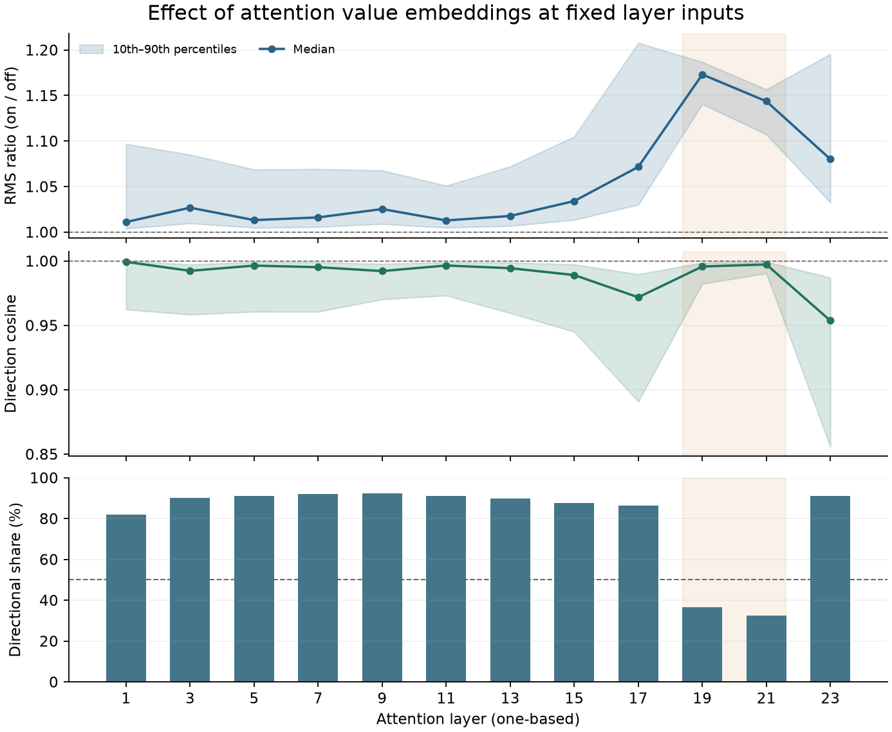

# How attention value embeddings change the 8k ChordRes update

The [matched-normal, zero-initial-velocity ChordRes checkpoint](https://wandb.ai/yibozhong657-none/nexttransformer-chordres/runs/1879c1a2) was evaluated at update 8,000. This is a frozen-checkpoint intervention. The higher scalar-LR training run continued independently.

## Paired diagnostic

We used the first 16 complete 2,048-token validation rows of each of the eight pinned ClimbMix packing streams. This yields 128 rows, 262,144 input positions and 261,867 non-special positions for geometry. At each of the 12 VE-enabled attention sites we evaluated the native BF16 FA3 attention and output projection twice at the same hidden state, with identical Q, K, RoPE and attention window. Only the VE contribution to V was suppressed on the second call. Both forces were also passed through the Chord write at identical input position, velocity and controls. The ordinary VE-enabled result continued through the network. Instrumentation reproduced the original per-token losses exactly on the first row of every rank.

For each pair of force vectors the total mean squared difference equals the squared RMS difference plus a directional term, 2 × RMS(on) × RMS(off) × (1 − cosine). The reported shares aggregate the squared terms before taking their ratio. Percentiles instead weight each non-special token and VE layer equally.

Across 3,142,404 comparisons, the median ratio is 1.0338 and the median cosine is 0.9934. Direction accounts for 66.36% of squared change (individual shard range 65.44–68.00%). Ten of twelve layers are direction-dominant. The median change to the actual Chord hidden write, expressed relative to the size of its intact update, is 12.58%.

| Layer | RMS on/off (P10 / median / P90) | Cosine (P10 / median / P90) | Directional share |
|---:|---:|---:|---:|
| 1 | 1.004 / 1.011 / 1.097 | 0.962 / 0.999 / 1.000 | 82.1% |
| 3 | 1.010 / 1.027 / 1.085 | 0.958 / 0.992 / 0.997 | 90.1% |
| 5 | 1.005 / 1.013 / 1.069 | 0.961 / 0.996 / 0.999 | 91.1% |
| 7 | 1.006 / 1.016 / 1.069 | 0.961 / 0.995 / 0.999 | 92.0% |
| 9 | 1.009 / 1.025 / 1.068 | 0.970 / 0.992 / 0.998 | 92.4% |
| 11 | 1.005 / 1.013 / 1.051 | 0.973 / 0.996 / 0.999 | 91.0% |
| 13 | 1.007 / 1.018 / 1.072 | 0.959 / 0.994 / 0.999 | 89.9% |
| 15 | 1.013 / 1.034 / 1.105 | 0.945 / 0.989 / 0.997 | 87.5% |
| 17 | 1.030 / 1.072 / 1.208 | 0.891 / 0.972 / 0.990 | 86.4% |
| 19 | 1.141 / 1.173 / 1.187 | 0.982 / 0.996 / 0.999 | 36.5% |
| 21 | 1.107 / 1.144 / 1.157 | 0.990 / 0.997 / 0.999 | 32.5% |
| 23 | 1.032 / 1.080 / 1.196 | 0.856 / 0.954 / 0.987 | 91.0% |

## End-to-end sensitivity

Subsequent passes disabled the indicated VE tables through the whole forward. They reused the exact same input and target bytes. The following BPB estimates describe the 262,144-token sample and should be compared with one another.

| VE tables disabled | Validation BPB | Change |
|---|---:|---:|
| None | 0.80916263 | -0.00000000 |
| Layers 19 and 21 | 0.84395580 | +0.03479317 |
| The other ten layers | 0.83992985 | +0.03076722 |
| All twelve | 0.94259001 | +0.13342738 |

The two late layers were chosen after inspecting their geometry. Their loss sensitivity includes propagation into later blocks. Effects across groups are nonadditive. These evaluations establish that VE changes directions and matters to this trained checkpoint. Testing whether VE reduces ChordRes gains relative to Standard Residual requires matched training controls.

[Full measurements and validation-sample fingerprints](artifacts/chordres-ve-direction-8k.json)
