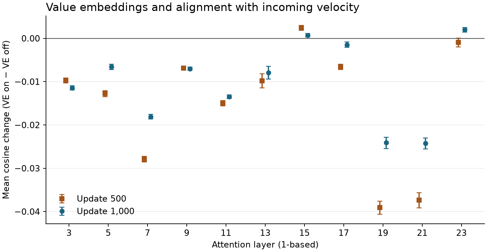

# Velocity alignment of the h-only Chord update

On the [fresh three-scalar h-only run](https://wandb.ai/yibozhong657-none/nexttransformer-chordres/runs/345e22ad), measure the signed cosine of the incoming velocity and the realized displacement, separately at every attention and MLP write:

```text
c = dot(v_in, h_out - h_in) / (norm(v_in) * norm(h_out - h_in))
```

Use the genuine stored BF16 positions and velocities and take the coordinate difference in FP32. At each of the 12 VE-enabled attention sites, compute the second attention and write locally with the same inputs, Q/K, gate coefficients, RoPE and window, suppressing only the additive value embedding. Propagate the intact output in both cases. Instrumentation reproduced the unmodified final hidden states exactly on the first row of each of the eight ranks. Validation row hashes match the [previous VE force-direction experiment](2026-11-23-chordres-ve-direction.md). Each checkpoint uses 128 packed sequences, or 262,144 input tokens; 261,867 positions have nonzero input-token byte length. Exclude exact zero velocity or displacement because the cosine is undefined. All first attention inputs start at zero velocity. The other 11 VE attention sites provide 2,880,537 valid token/site pairs per checkpoint.

## Paired VE effect

| Update | Mean with VE | Mean without local VE | Paired mean change | 95% row-bootstrap interval | Mean absolute paired change | Negative cosine, on / off |
| ---: | ---: | ---: | ---: | --- | ---: | ---: |
| 500 | 0.19243 | 0.20730 | -0.01487 | [-0.01527, -0.01448] | 0.02353 | 15.39% / 14.00% |
| 1,000 | 0.20575 | 0.21590 | -0.01014 | [-0.01051, -0.00982] | 0.01743 | 16.02% / 15.52% |

The bootstrap resamples the 128 packed rows, retaining all tokens and layers of a sampled row together (2,500 replications). As a sphere-specific check, projecting both vectors onto the tangent plane at the incoming h produced mean paired differences of -0.01496 and -0.01019, respectively.

At update 1,000 the VE-on and VE-off displacement directions themselves had a median cosine of 0.9337, while only 2.24% of the corresponding cosines against incoming velocity changed sign. The greatest mean decreases in alignment were at layers 19 and 21. The intervention measures local geometry on the intact trajectory. A training-performance attribution to VE would require a matched training comparison.



| Intact sublayer group | Mean cosine at 500 | Mean cosine at 1,000 | Median cosine at 1,000 | Negative fraction at 1,000 |
| --- | ---: | ---: | ---: | ---: |
| VE attention (excluding first) | 0.19243 | 0.20575 | 0.19050 | 16.02% |
| Attention without a VE table | 0.14369 | 0.14143 | 0.13944 | 18.59% |
| MLP | 0.08864 | 0.08329 | 0.06923 | 33.68% |

[Layerwise values, counts, quantiles and input fingerprints](artifacts/honly-ve-velocity-displacement-cosine.json).
